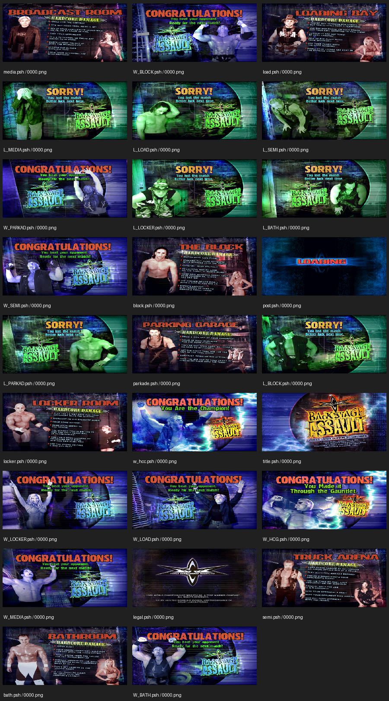
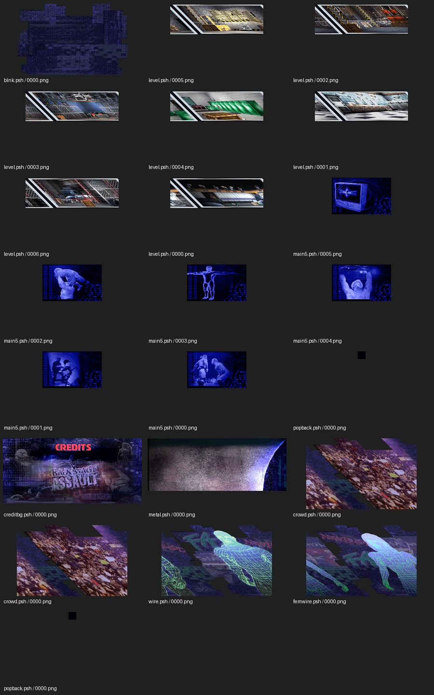

# WCW Backstage Assault — Native Windows Recompilation (Experimental)

**Work in progress · Stage 15B.3 · PlayStation SLUS-01274 (USA) · Windows x64**

An unofficial experimental Windows PC port of **WCW Backstage Assault** (original PlayStation version by Kodiak Interactive) using static MIPS-to-C recompilation with [PSXRecomp](https://github.com/mstan/psxrecomp). The compiled executable uses the PSXRecomp runtime, SDL3, OpenGL, and OpenBIOS. This repository records development sources, selected runtime patches, build configuration and the ongoing work; it is **not** an official game release.

**Credits and research:** The technical approach, build structure, runtime integration ideas and some initial comparisons were informed by [dotGrx/WCW-Mayhem-RECOMP](https://github.com/dotGrx/WCW-Mayhem-RECOMP). That is a separate recompilation project for **WCW Mayhem**, not a port of Backstage Assault; its game-specific function addresses, patches, and assets were not transplanted into this game. Further credit to the authors and contributors of PSXRecomp, SDL3 and OpenBIOS. Refer to their upstream licences.

## Screenshots

Captured from the native Windows recompilation during development.

| Backstage gameplay — In-game options | Global options — Audio and controller settings |
| --- | --- |
|  |  |

### Main menu and options

| Main menu | Advanced Options — proposed native menu layout |
| --- | --- |
|  |  |

### Experimental cheats interface

Native menu integration remains in development; the cheats interface shown is experimental.

### Original graphics research

Reference sheets for planned static texture enhancements, not screenshots of completed HD replacement rendering.

**Loading backgrounds**

**Wrestler faces**

**Main menu background components**

## Downloads

[Windows x64 experimental pre-release v0.15B.3](https://github.com/khant735/WCW-Backstage-Assault-RECOMP/releases/tag/v0.15B.3) — automated compilation and release publishing verified; gameplay testing of the published build remains pending.

## Working / observed

- Native Windows x64 executable has compiled and run on a Windows test PC with a supplied Backstage Assault disc image; gameplay was reported near-perfect in an earlier Stage 14 build, with keyboard input. This is user testing rather than automated compatibility coverage.
- Wired PS4 pad: D-pad and left analogue movement confirmed working after setting `[controller] p1_device = "auto"`, with the configured digital or analogue mode. Right stick does **not** yet control the camera.
- FPS on-screen statistics: initially failed in Stage 15B, corrected and **confirmed by user** in Stage 15B.1.
- F9 picture stretching/window aspect switching: **confirmed by user** in Stage 15B.2, but not true additional scene rendering.
- Stage 15B.3: added experimental 16:9, 17:9 and 21:9 projection modes using the framework GTE widescreen path. It **compiled** but user gameplay verification of increased field of view, clipping and HUD is still pending.
- Optional separate `AdvancedOptions.exe` existed in a Stage 15A distribution; it is **not integrated** into the original menu. It is not included in this source archive.

## Display modes (F9)

| Mode | Reference window size | Current status |
| --- | --- | --- |
| 4:3 original | 960 × 720 | Fallback |
| 16:9 stretch | 1280 × 720 | Window stretch confirmed |
| Fill | Window-dependent | Stretch mode |
| 17:9 stretch | 1360 × 720 | Added; needs testing |
| 21:9 stretch | 1680 × 720 | Added; needs testing |
| 17:9 projection | 1360 × 720 | Experimental; not yet confirmed in game |
| 21:9 projection | 1680 × 720 | Experimental; not yet confirmed in game |
| 16:9 projection | 1280 × 720 | Experimental; not yet confirmed in game |

**F11** toggles FPS reporting. **F10** was designated for advanced options, but full in-game menu integration is not done. Stretching the framebuffer is **not** true widescreen; extra 3D scenery requires projection/culling changes and testing. Menu/2D/video framing may require separate fixes.

## Contents

- `generated/`: MIPS-to-C generated game program/overlay code produced in development (potentially game-derived copyrighted material; see legal note).
- `seeds/`, `game.toml`: game identity, recompiler and overlay settings.
- `CMakeLists.txt`, `build-windows.ps1`, `compat/`: Windows build files.
- `runtime_patches/`: source diffs against **PSXRecomp revision `8077e71098ce0347d7d41d267630bc856816cf77`**. These cover input/display/FPS/OSD work and related compatibility edits.
- `Launch_*.cmd`: reference launcher commands from Stage 15B.3; run from your **build distribution folder** alongside the EXE.
- `docs/`: test history, roadmap, original scripts/compile diagnostics.

## Building

1. Obtain the exact PSXRecomp revision above from its upstream project. Consult its **PolyForm Noncommercial 1.0.0** terms; commercial use requires separate permission. Extract as `psxrecomp/` beside this README.
2. Apply patches in `runtime_patches/` from the `psxrecomp/` directory. With Git installed: `git apply ../runtime_patches/*.patch` on compatible Git Bash, or apply individually using `git apply ../runtime_patches/<patch-file>`. The patches represent modifications **to the upstream framework**, not to the game-generated sources.
3. Install the required Windows x64 C/C++ toolchain, CMake, Ninja, Python, SDL3 dependencies and use `build-windows.ps1` as a starting point. The tested development environment cross-compiled from Linux using LLVM-MinGW UCRT and SDL3 3.4.18; the Windows PowerShell build has since passed GitHub Actions.
4. Supply your **own legally obtained** Backstage Assault USA BIN/CUE separately under `disc/` as configured in `game.toml`, with any required BIOS/runtime resources under the locations expected by PSXRecomp. Original discs and commercial game images are not included; selected graphics reference sheets are shown above.
5. Build and run the result, for example through a `Launch_*.cmd` file from the executable directory.

**Reproducibility caveat:** Stage 15B.3 compiled successfully with this local framework working tree, but the public-source layout has since compiled successfully in GitHub Actions; runtime testing of the published build remains pending. See [build notes](docs/BUILD_AND_PROVENANCE.md).

## Next improvements

See [ROADMAP.md](docs/ROADMAP.md): actual extended widescreen visibility and 17:9/21:9 testing, automatic game camera plus right-analogue manual control, improved video/MDEC playback and block smoothing, HDD file-backed virtual CD reads with timing preserved, advanced options integrated in game, additional diagnostics and regression testing.

## Legal / distribution

This fan research project is not affiliated with Sony, WCW, WWE, Kodiak Interactive, or original rights holders. No PlayStation game disc, BIN/CUE or licensed BIOS is distributed here. Selected original graphics reference sheets are included for research; rights remain with their respective owners. The generated C source is derived from analysis of the game executable and may be subject to the game's original copyright; public redistribution requires an independent rights assessment. No licence is asserted over third-party game content. PSXRecomp and its runtime are subject to **PolyForm Noncommercial 1.0.0**. SDL3 and OpenBIOS have their respective licences. The upstream [WCW-Mayhem-RECOMP](https://github.com/dotGrx/WCW-Mayhem-RECOMP) project is credited as a technical reference; this repository does not imply its authors endorse this port.
